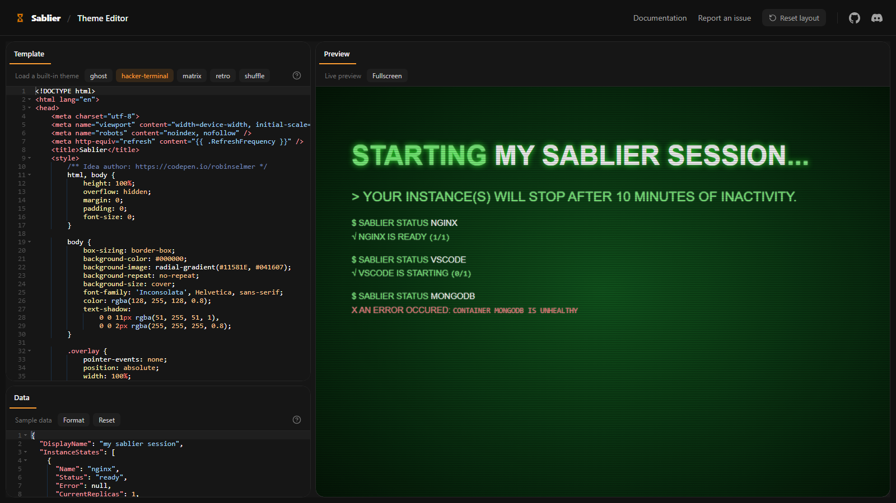

# Sablier Theme Editor

Edit and preview themes directly in the browser!

[Start editing at https://editor.sablierapp.dev/ !](https://editor.sablierapp.dev/)

## Why ?

Sablier themes are Golang [html/templates](https://pkg.go.dev/html/template) because data is fed at access time.

This website allows you to live edit and preview Golang [html/templates](https://pkg.go.dev/html/template) with data.

## Features

- Rich editor (See [Ace (Ajax.org Cloud9 Editor)](https://github.com/ajaxorg/ace))
- Theme input data window with [JSON Schema](./webui/theme.schema.json)
- Golang html/template preview in the browser (With WebAssembly), rendered with the same data as Sablier
- Load the built-in themes from [Sablier](https://sablierapp.dev/how-to-guides/loading-strategies/customize-theme/)
- Rearrange and resize the template, data and preview panels
- Editor content and layout are saved to local storage

## Development

Run `make dev` and open http://localhost:8090 (requires Go and Node.js).

The page reloads on every change in `webui`, and the wasm is rebuilt whenever a `.go` file changes. Use `make dev PORT=3000` to serve on another port.

## Credits

This website was inspired by:
- https://gotemplate.io/
- https://ataylor.io/blog/go-templates/